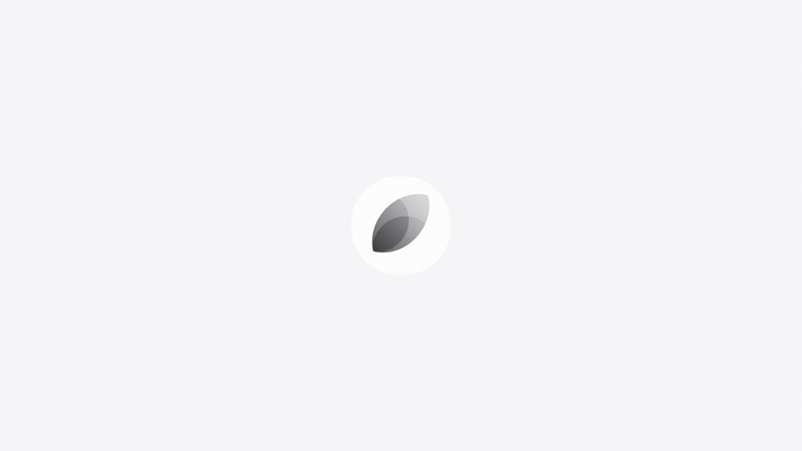

**Engenheiro Full Stack, Mobile e IA**
Ponta Grossa, Paraná, Brasil

 

[Assistir em vídeo (MP4)](assets/intro.mp4)

---

## Sobre

Desenvolvo aplicativos mobile em React Native, sistemas full stack e agentes de IA. Tenho apps publicados na App Store e no Google Play e construí o servidor MCP que conecta o Claude ao painel interno da Inbix, com acesso somente leitura. Atuo na Inbix e na Uspectro.

## Stack

**Mobile**
        

**Testes e qualidade**
    

**Full Stack e backend**
       

**IA e LLM**
     

**Cloud e DevOps**
      

## Estudando agora

- **AWS:** projeto de processamento de pedidos em fases (API, fila, worker e banco), com API Gateway, Lambda, DynamoDB, SQS e CDK. Estou no começo: já fiz a parte de conceitos e a primeira stack.
- **Plataformas Apple:** Swift e SwiftUI para criar apps nativos. Repositórios de estudo: [Swift](https://github.com/JonathannBarbosa/Swift) e [MVVM com SwiftUI](https://github.com/JonathannBarbosa/mvvm-swiftui-study).
- **Mensageria:** [estudo de Apache Kafka com Docker](https://github.com/JonathannBarbosa/apache-kafka).

---

[Portfólio](https://jonathan-azevedo-dev.vercel.app) · [LinkedIn](https://www.linkedin.com/in/jonathan-barbosa-azevedo-b942a011b/)

